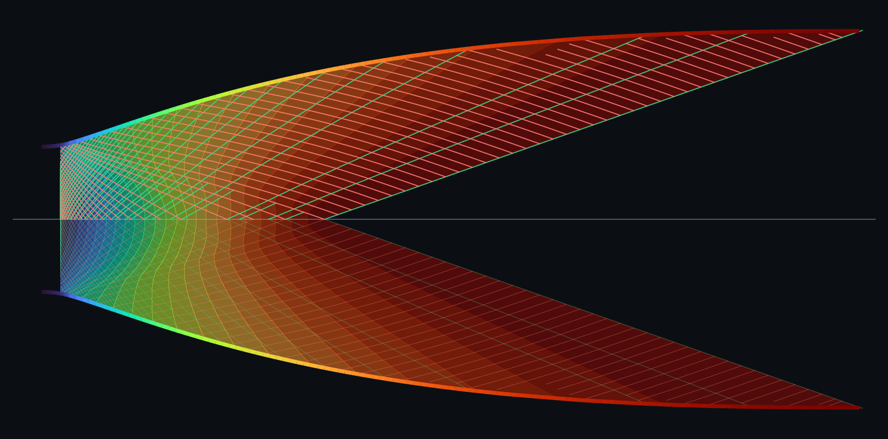
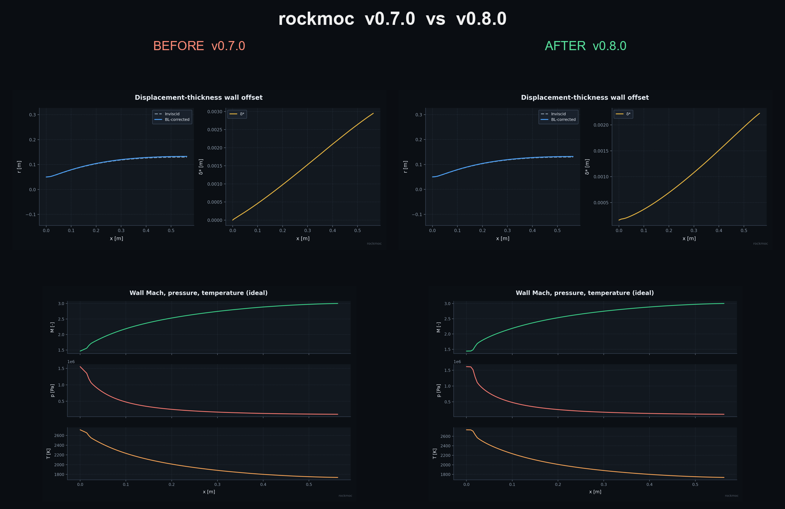
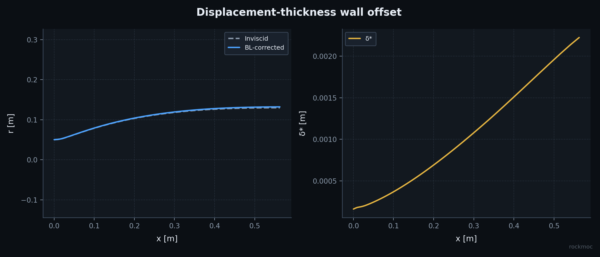
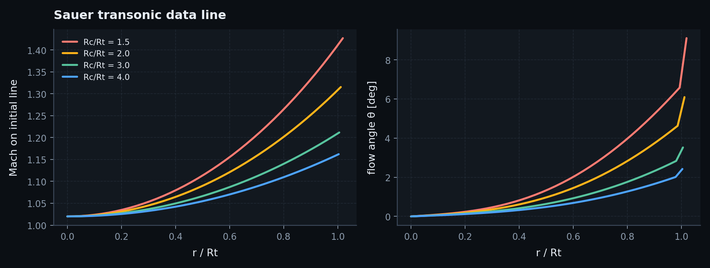
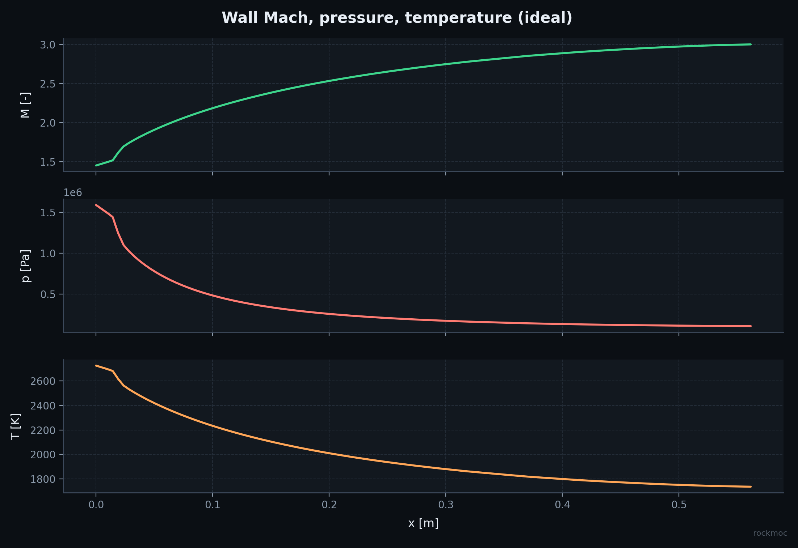
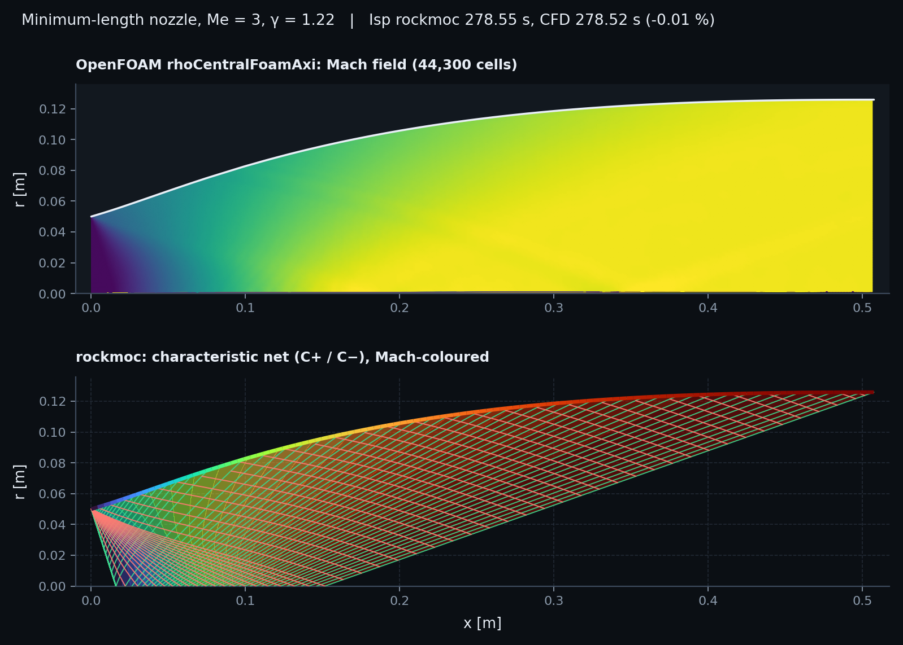
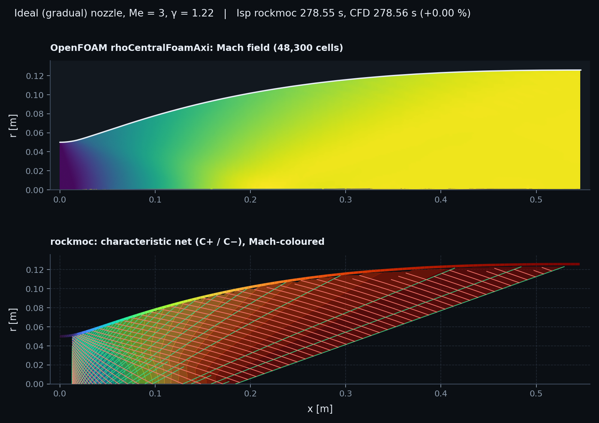
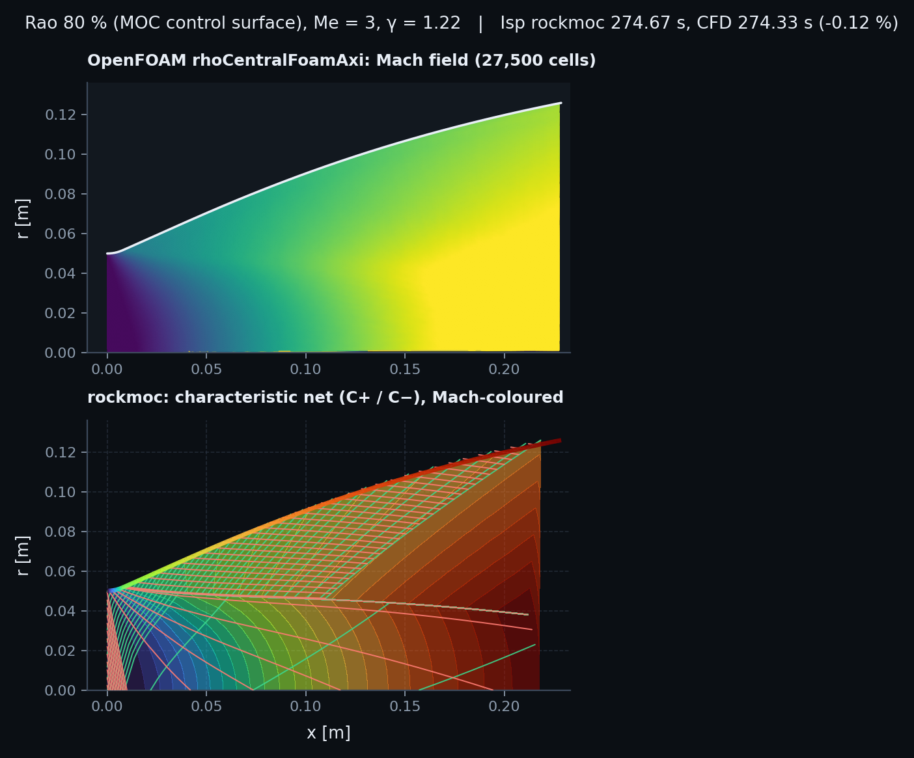
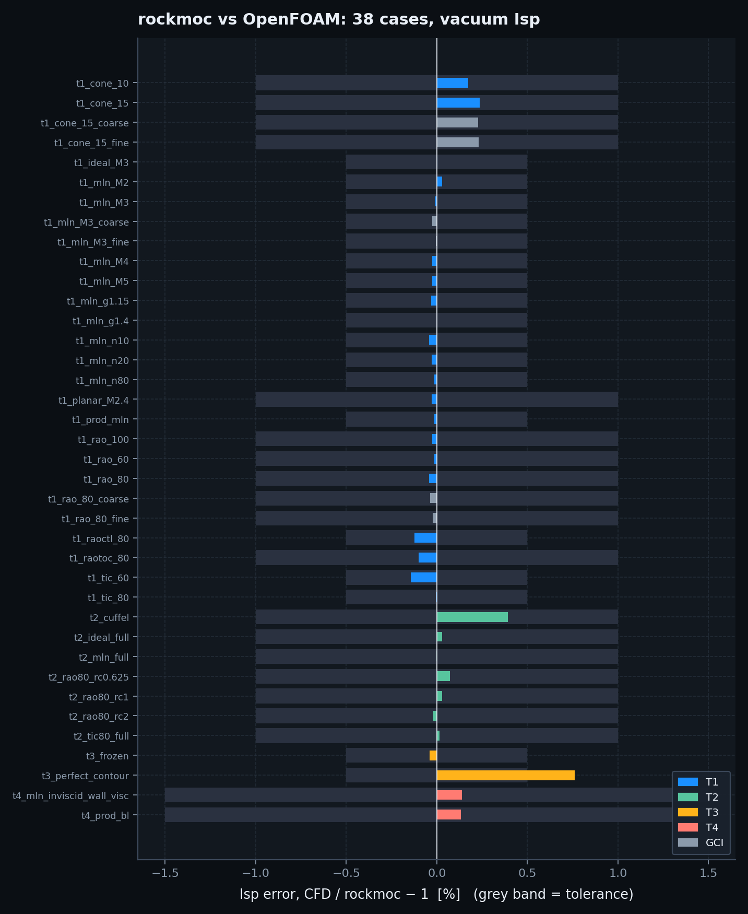

# rockmoc

Method of Characteristics rocket nozzle design in Python: MLN, Rao, TIC and aerospike contours with real-gas thermochemistry.

```bash
pip install rockmoc
```

**Live demo:** [aboutkvs.vercel.app/rockmoc.html](https://aboutkvs.vercel.app/rockmoc.html)

**Industry-oriented Method of Characteristics (MOC) rocket nozzle design for Python.**

Design conventional bells (MLN, ideal, TIC, Rao TOP/TOC), **planar NASA sharp-throat MLNs**, and **annular aerospikes** from literature-faithful algorithms — with pluggable thermochemistry, boundary-layer correction, field-integrated performance, dark-themed plots, and a multi-regime validation campaign against NASA/NACA/Rao sources.

| | |
|--|--|
| **Website** | **[aboutkvs.vercel.app/rockmoc.html](https://aboutkvs.vercel.app/rockmoc.html)** — full portfolio showcase |
| **Version** | 1.0.0 (`src/rockmoc/_version.py`) · [PyPI](https://pypi.org/project/rockmoc/) |
| **Python** | ≥ 3.10 |
| **Core deps** | NumPy, SciPy |
| **License** | MIT |
| **Author** | [shanthoshkv](https://github.com/shanthoshkv) |
| **Repo** | https://github.com/shanthoshkv/rockmoc |



*An axisymmetric nozzle solved by the method of characteristics: C+ / C− families, expansion fan, and the Mach field behind them.*

---

## Table of contents

- [**How to use (full guide)**](https://github.com/shanthoshkv/rockmoc/blob/main/docs/how_to_use.md) ← start here if you are new
- [**Project website**](https://aboutkvs.vercel.app/rockmoc.html) — interactive gallery, validation, API overview
- [What rockmoc is](#what-rockmoc-is)
- [What's new in v1.0.0](#whats-new-in-v100)
- [What's new in v0.9.0](#whats-new-in-v090)
- [What's new in v0.8.0](#whats-new-in-v080)
- [Nozzle types](#nozzle-types)
- [Capabilities](#capabilities)
- [Install](#install)
- [Quickstart](#quickstart)
- [Dark plots & post-solve dashboard](#dark-plots--post-solve-dashboard)
- [Validation](#validation)
- [API map](#api-map)
- [Assumptions & limits](#assumptions--limits)
- [Project layout](#project-layout)
- [CLI](#cli)
- [References](#references)
- [Contributing / release checklist](#contributing--release-checklist)
- [License](#license)

> **New to rockmoc?** Start here:  
> - **[Project website](https://aboutkvs.vercel.app/rockmoc.html)** — figures, validation, and overview  
> - **[How to use (full guide)](https://github.com/shanthoshkv/rockmoc/blob/main/docs/how_to_use.md)** — install, first design, student helpers, FAQ  
> - **[Jupyter tutorials](https://github.com/shanthoshkv/rockmoc/tree/main/examples/notebooks)** — MLN, compare, altitude, NASA planar  
> - **[Homework problems](https://github.com/shanthoshkv/rockmoc/blob/main/docs/student_problems.md)**  
> - **[Glossary & symbols](https://github.com/shanthoshkv/rockmoc/blob/main/docs/glossary.md)**  

---

## What rockmoc is

rockmoc is a **library + CLI** for *preliminary-to-production-engineering* nozzle contour design using the **method of characteristics**, not a full CFD solver.

It is built for:

- Propulsion students and researchers who need **reproducible MOC contours**
- Rocket teams who want **MLN / TIC / Rao / aerospike** options in one package
- Pipelines that export walls to **CAD / CFD** and attach **CEA / Cantera / CoolProp** γ later

**Coordinate system:** SI meters; geometric throat at \(x = 0\), wall radius \(r = R_t\); API angles in **radians** (summaries often print degrees).

---

## What's new in v1.0.0

v1.0.0 is the **OpenFOAM validation release** (first stable release; 0.10.0 on PyPI is the same code). 45 CFD cases (`cfd_validation/`) compared rockmoc against `rhoCentralFoamAxi`, and the disagreements turned into fixes:

- One geometric exit-loss factor instead of two (the divergence loss was counted twice, 1.6–3.8 % low on Isp).
- Rao TOP angle trend corrected, true quadratic-Bézier parabola; Rao TOC built at its target length.
- Ideal/TIC throat arc resampled (no 3–6° kinks in exported walls).
- Separation evaluated on the real wall pressure, Kalt–Badal recovery by default.
- Boundary-layer loss charged as the exit control volume, not as ∫τ_w dA.
- Kliegel–Levine throat start line up to Rc/Rt = 4; planar MLN wall rebuilt from the characteristic network; CLI default `-n` 80.

Result: Isp within **0.04 %** of CFD for MLN, ideal, TIC and production nozzles, and within 0.25 % for cones and Rao bells. 291 of 333 gated checks pass. See [Against OpenFOAM](#against-openfoam-45-cfd-cases-291-of-333-gated-checks-pass) and [CHANGELOG.md](CHANGELOG.md).

## What's new in v0.9.0

v0.8.0 fixed the physics around the contour. v0.9.0 makes the **gas real**, adds **batch sweeps**, and finishes the **units and export** story.

### Real-gas nozzle flow

A constant-γ gas cannot follow a LOX/RP-1 expansion: γ goes from about 1.14 at the throat to 1.2–1.3 at the exit, and the molecular weight changes with it. `--propellants LOX/RP1 --of 2.4 --pc 7e6` now builds an expansion table straight from RocketCEA (equilibrium by default, `--gas-model frozen` for composition frozen at the throat). γ, T, ρ, a and the Prandtl–Meyer angle all come from that table, and the MOC, area ratio, Cf and Isp all see the same gas.

Same design (ε = 25, LOX/RP-1, 70 bar, O/F 2.4, 80 characteristics):

| Gas model | Exit Mach | L / R<sub>t</sub> | Isp vac |
|-----------|----------:|------------------:|--------:|
| constant γ (throat value, 1.142) | 3.656 | 23.3 | 350.1 s |
| **equilibrium** (real gas) | 3.785 | 24.0 | **346.4 s** (RocketCEA: 346.4 s) |
| frozen at throat | 4.042 | 25.5 | 332.8 s |

The constant-γ gas overstates equilibrium Isp by about 1 % and puts the exit Mach and the wall length in the wrong place. Real engines sit between frozen and equilibrium, so `--vary gas_model=frozen,equilibrium` gives the bracket.

How it was checked: exit Mach, Isp (within 0.1 %) and c\* (1e-5) reproduce RocketCEA's own numbers, and an independent Cantera expansion of LOX/LH2 agrees on exit temperature (within 0.5 %) and exit velocity (within 0.15 %).

### Batch sweeps

```bash
rockmoc sweep --propellants LOX/RP1 --of 2.4 --vary of=2:3:6 --vary pc_bar=30:100:8 \
              --vary pe_pc=0.005,0.01 --vary gas_model=frozen,equilibrium --jobs 4 --out sweep.csv
```

Cartesian grid over exit Mach, area ratio, pe/pc, exit pressure, chamber pressure, T<sub>c</sub>, ambient pressure or altitude, O/F, gas model, γ, R, R<sub>t</sub>, characteristics, R<sub>c</sub>/R<sub>t</sub>, nozzle type and more. One CSV row per case (geometry, C<sub>F</sub>, Isp, thrust, mass flow, γ at throat and exit); a failing case is recorded in an `error` column and the rest of the grid still runs. A `[sweep]` table in a TOML spec does the same through `rockmoc run`.

### Units, export, and the rest of the CLI

- **Units** `m, cm, mm, in, ft` on input (`--in-units`) and output (`--units`); the solver stays SI.
- **Export** with a chosen point count (`--points`, `export_contour(path, n=, units=)`) to `csv` / `txt`, plus `sldcrv` (SolidWorks), `shell` (inner + outer wall for jacket CAD), DXF, OpenFOAM (`blockMeshDict` in your units) and `--stdout`.
- **Performance** from any design: `result.performance(pc, Tc, pa)` returns C<sub>F</sub>, Isp, thrust and mass flow.
- `rockmoc validate spec.toml` checks a spec without solving; `rockmoc compare a.csv b.csv` reports the wall deviation between two files.

### Fixed

- **2-D Euler throat solver converges** (residual 3e-2 → 1e-7, about 2.5× faster). The old subsonic inflow condition was unstable; the Cuffel and Kliegel–Levine results still land inside the published tolerances.
- RocketCEA returns temperatures in °R; three places used them as K (T<sub>c</sub> was 1.8× too high).

### Checked and left alone

The axisymmetric MLN wall peaks near 15.5° while the corner angle is about 11.7° (γ = 1.4, M<sub>e</sub> = 3). That is physics, not overshoot: it is mesh-converged and the source terms match the exact conical source flow. `theta_max_rad` is the corner angle and `max_wall_angle_rad` is the peak.

Tests: 145 fast and 3 slow tests pass. See [CHANGELOG.md](CHANGELOG.md) for the full list.

---

## What's new in v0.8.0

v0.7.0 got the core MOC physics right (C− sign, a real axisymmetric MLN, MOC-built ideal and Rao contours). v0.8.0 is about the parts around the contour: the throat, the boundary layer, and the losses you subtract at the end. It also swaps "trust me" for a gated comparison against published data.



*Same Mach-3 design run through both releases. The wall contour barely moves. The boundary layer and the wall state at the throat do.*

### v0.7.0 → v0.8.0 at a glance

| Area | v0.7.0 | v0.8.0 |
|------|--------|--------|
| **Boundary layer** | Flat-plate style estimate | Compressible momentum-integral (von Kármán) solve, Bartz two-thickness energy integral, chamber-inlet start, cooled walls via `wall_temperature`. Flat-plate kept as a fallback with a warning. |
| **BL accuracy vs TN D-5377** | Cooled-inlet θ sat 38–43 % low | Cooled-inlet θ is inside the measured band. Worst adiabatic δ\* error down from +27 % to +14 %. |
| **Transonic throat** | Sauer only, fine for Rc/Rt ≳ 2 | Hall 3rd order (Rc/Rt ≥ 1.5), Kliegel–Levine (0.4 ≤ Rc/Rt < 1.5), and a 2-D Euler solver for tighter throats. |
| **Tight-throat check** | None, no reference | Cuffel 1969 at Rc/Rt = 0.625: axis Mach 0.79 vs 0.8 measured, Cd 0.982 vs 0.985. |
| **Losses** | 1-D Cf and field Cf | Adds friction loss, chemical efficiency bounds, two-phase loss, and flow separation checks (Summerfield, Kalt–Badal, Schmucker and others). |
| **Kinetics** | Frozen γ only | Quasi-1-D finite-rate nozzle via Cantera. Zero rate lands on frozen, fast rate on shifting equilibrium. |
| **Internal shocks** | Not detected | Wall detector flags TOP parabolas and arc-throat cones, stays quiet on ideal contours. |
| **Variable γ** | Closed forms at local γ | Integrates the thermally perfect isentrope. |
| **Validation** | Self-consistency and identities | **74 gated checks against published data**, 123 tests total. |

### The two plots that show the change

| Boundary layer (δ\* wall offset) | Transonic data line by Rc/Rt |
|:--:|:--:|
|  |  |
| δ\* now starts from the chamber inlet instead of zero at the throat, so the wall offset already has a physical value where the flow goes sonic. | The throat initial line depends strongly on Rc/Rt. This is why one method cannot cover the whole range, and why v0.8.0 picks Hall, Kliegel–Levine or Euler by curvature. |

Full list of changes: [CHANGELOG.md](CHANGELOG.md).

---

## Nozzle types

| Type | Function(s) | Geometry | Typical use |
|------|-------------|----------|-------------|
| **Planar MLN** | `design_planar_mln_nasa` | 2D sharp-throat minimum-length, uniform exit | Turbine nozzles, educational MOC, NASA TM-X-1502 parity |
| **Axisym MLN** | `design_mln` | Axisymmetric sharp-throat minimum-length bell | Short high-ε vacuum stages, upper stages |
| **Ideal** | `design_ideal` | Circular throat arc + elongated canceling region | Full-length “ideal” contoured bell reference |
| **TIC** | `design_tic` | Truncated ideal contour (`truncate_fraction`) | Flight trade: length vs performance |
| **Rao TOP** | `design_rao` | Thrust-optimized parabolic / engineering TOP | Industry-standard compact high-thrust bells |
| **Rao TOC** | `design_rao_toc`, `design_rao_control` | Length-referenced / control-surface TOC variants | Advanced TOP–TOC studies |
| **Conical** | `design_conical` | Constant half-angle wall (default **15°**) | Textbook baseline vs MOC / TOP |
| **Aerospike (full)** | `design_spike` | Annular plug (Lee / Vernacchia) | Altitude-compensating engines |
| **Aerospike (truncated)** | `design_spike_truncated`, `truncated_spike_with_base` | Truncated spike + base pressure models | Practical plug nozzles |
| **Spike + cowl** | `design_spike_with_cowl`, `design_primary_cowl` | Primary cowl + spike stack | Integrated aerospike packages |
| **Production package** | `design_production` | Any of MLN/ideal/TIC/Rao + BL + field Cf + UQ | Recommended “ship the design” path |

### Contour family (same Me, γ)

Typical length ordering at fixed design point:

```text
MLN  <  Rao TOP (~0.8 × 15° cone)  ≲  TIC (e.g. 80% ideal)  <  Ideal
(+ conical 15° as length/angle baseline)
```

Use `compare_nozzle_designs(spec)` (includes cone by default) then:

```python
cmp = compare_nozzle_designs(spec)
print(cmp.to_markdown())   # lab report
cmp.to_csv("compare.csv")
```

**Student helpers:** `DesignSpec.student`, `example_gas`, `result.report()`, `result.lab_report()`, `explainer("mln")`, `KNOWN_LIMITS` — see [how to use](https://github.com/shanthoshkv/rockmoc/blob/main/docs/how_to_use.md#9-student-helpers-reports-gases-tables-cone).

---

## Capabilities

### Design & mesh

- **Axisymmetric MOC** unit processes (interior / axis / wall) with geometric source terms (Zucrow–Hoffman style)
- **Planar NASA MOC** (TM-X-1502): θ_max = ν_e/2, y_e = A/A*, mesh Δν control
- Dense defaults for accuracy (`n_characteristics` ~ 160, planar Δν down to 0.1°)
- Mesh studies: `mesh_convergence_planar`, `mesh_convergence_axisym`
- Optional **strict canceling wall** + robust schedule fallback
- **Isotropic area match** so geometric ε tracks 1-D A/A*(Me) without warping wall angles

### Thermochemistry

| Backend | Install | Role |
|---------|---------|------|
| `PerfectGas` | core | Constant-γ isentropic / PM |
| `VariableGammaGas` + expansion tables | core | Multi-γ along M (chamber → throat → exit) |
| **Real gas** (`build_cea_table`) | `pip install rocketcea` | Equilibrium / frozen γ(T), ρ, a, ν(M) from RocketCEA; default with `--propellants` |
| RocketCEA (constant-γ) | `pip install rockmoc[cea]` | Single frozen throat γ, R, Tc (`--gas-model perfect`) |
| Cantera | `pip install rockmoc[cantera]` | Equilibrium / frozen mixtures |
| CoolProp | `pip install rockmoc[coolprop]` | Pure-fluid properties |

### Accuracy stack (production)

`design_production(...)` chains:

1. Fine MOC design (MLN / ideal / TIC / Rao)  
2. Expansion table (perfect-gas or multi-γ)  
3. Sauer-style **throat IVL** metadata  
4. Optional **BL δ\*** wall growth (TM-X-2343 spirit)  
5. **Field-integrated Cf / Isp** on the exit station  
6. Altitude off-design sweep  
7. Optional **mesh certificate / UQ** hooks  

### Performance & analysis

- 1-D ideal \(C_F\), \(I_{sp}\) (Sutton form)
- Exit-plane **divergence / kinetic** efficiencies (θ_e-based — no false wall-history penalty)
- `off_design_altitude_sweep` with ISA-style \(p_a(h)\)
- OF / γ / ε design **sweeps** for trade plots
- Monte Carlo / one-at-a-time sensitivity / mesh certificate

### Plotting (optional `rockmoc[plot]`)

Dark aerospace theme:

- Nozzle contour (mirrored walls, metrics box, wall-angle colormap)
- **MOC field**: C+, C−, expansion fan, canceling C−, wall nodes
- Wall profiles r(x), θ(x), M(x)
- Mach & p/p_c along wall
- Performance vs altitude
- O/F, γ, ε sweeps
- Family overlay + comparison bars
- Aerospike contour
- BL inviscid vs corrected

```python
result = design_mln(spec, store_net=True)
result.plot()                              # display dashboard
result.plot(show=False, save_dir="out")    # optional PNG save
```

### Export

```python
result.export_csv("wall.csv")
result.export_json("wall.json")
result.export_contour("wall.txt", n=200, units="mm")   # .csv or .txt, chosen point count
result.performance(pc=7e6, Tc=3600.0, pa=0.0)          # Cf, Isp, thrust, mdot
# Contour also: result.contour.export_csv / export_json
```

---

## Install

### From PyPI

```bash
pip install rockmoc
pip install "rockmoc[plot]"       # figures (CLI needs no extra)
pip install "rockmoc[fast]"       # Numba-compiled MOC kernels
pip install "rockmoc[viz]"        # interactive Plotly field
pip install "rockmoc[all]"        # all optional extras
```

### From GitHub

```bash
pip install "git+https://github.com/shanthoshkv/rockmoc.git"
```

### From a clone (development)

```bash
git clone https://github.com/shanthoshkv/rockmoc.git
cd rockmoc
pip install -e ".[plot,dev]"

# Optional chemistry stacks
pip install -e ".[cea]"
pip install -e ".[cantera]"
pip install -e ".[coolprop]"
```

**Requirements:** Python ≥ 3.10, NumPy ≥ 1.24, SciPy ≥ 1.10.

Publishing notes for maintainers: see [PUBLISH.md](https://github.com/shanthoshkv/rockmoc/blob/main/PUBLISH.md).

---

## Quickstart

For a slower, more detailed tour (inputs, mesh, exports, FAQ), see the **[full how-to guide](https://github.com/shanthoshkv/rockmoc/blob/main/docs/how_to_use.md)** or the **[project website](https://aboutkvs.vercel.app/rockmoc.html)**.

### Axisymmetric MLN

```python
from rockmoc import PerfectGas, DesignSpec, design_mln

gas = PerfectGas(gamma=1.25, R=350.0)
spec = DesignSpec(
    gas=gas,
    throat_radius=0.05,      # m
    exit_mach=3.0,           # or area_ratio=... or pressure_ratio=...
    n_characteristics=80,
)
result = design_mln(spec, store_net=True)
print(result.summary())
result.export_csv("mln_wall.csv")
result.plot(show=True)       # needs rockmoc[plot]
```

### Ideal, TIC, Rao

```python
from rockmoc import design_ideal, design_tic, design_rao, DesignSpec, PerfectGas

spec = DesignSpec(PerfectGas(1.25), throat_radius=0.05, exit_mach=3.0, n_characteristics=64)

ideal = design_ideal(spec)
tic   = design_tic(DesignSpec(PerfectGas(1.25), throat_radius=0.05, exit_mach=3.0,
                              n_characteristics=64, truncate_fraction=0.80))
rao   = design_rao(spec, length_fraction=0.80)
```

### NASA planar MLN (TM-X-1502 sample)

```python
from rockmoc import design_planar_mln_nasa

# Paper sample: Me = 4.05, γ = 1.36
r = design_planar_mln_nasa(4.05, 1.36, dnu_deg=0.1, throat_half_height=0.05)
print(r.summary())
r.contour.export_csv("planar_mln.csv")
```

### Aerospike

```python
from rockmoc import design_spike, design_spike_truncated

spike = design_spike(
    Pc=5e6, Tc=3200.0, gamma=1.25, molar_mass=22.0,
    Re=0.15, expansion_ratio=25.0, Pa=0.0, n_points=5000,
)
print(spike.summary())
trunc = design_spike_truncated(spike, length_fraction=0.25)
```

### Production pipeline (recommended)

```python
from rockmoc import PerfectGas, DesignSpec, design_production

prod = design_production(
    DesignSpec(PerfectGas(1.25), throat_radius=0.05, exit_mach=3.0),
    kind="mln",                      # mln | ideal | tic | rao
    apply_bl=True,
    multi_gamma=(1.25, 1.22, 1.18), # optional γ_c, γ_t, γ_e
    pc=5e6,
    Tc=3200.0,
)
print(prod.summary())
prod.plot(show=False, save_dir="figures")
# prod.design.contour  — inviscid wall
# prod.bl.corrected    — BL-grown wall
# prod.field           — field Cf / Isp
```

### Fair comparison

```python
from rockmoc import DesignSpec, PerfectGas, compare_nozzle_designs

cmp = compare_nozzle_designs(
    DesignSpec(PerfectGas(1.25), throat_radius=0.05, exit_mach=3.0, n_characteristics=40)
)
print(cmp.summary_table())
```

### Chemistry-backed gas (optional)

```python
from rockmoc.thermo.rocketcea_backend import RocketCEAGas  # rockmoc[cea]

cea = RocketCEAGas(ox="LOX", fuel="LH2", of_ratio=5.0, Pc_psia=500.0)
gas = cea.solve()  # PerfectGas-like with frozen throat γ, R
```

---

## Dark plots & post-solve dashboard

```bash
pip install -e ".[plot]"
py -3.12 tests/generate_all_graphs.py   # writes tests/graphs/*.png
```

| Figure family | Contents |
|--------------|----------|
| Contour | Mirrored wall, throat/exit markers, metric box |
| MOC field | C+/C−, fan, canceling C−, wall & axis nodes |
| Wall profiles | r(x), θ(x), M(x) |
| Thermo edge | M(x) and p/p_c(x) |
| Altitude | C_F and I_sp vs h |
| Sweeps | O/F, γ, ε |
| Family | Overlay + bar comparison |
| Aerospike | Spike + lip radius |
| BL | Inviscid vs δ*-corrected wall |

Saving is always optional (`save_dir=None` → display only).

---

## Validation

rockmoc ships an offline, literature-anchored validation campaign. There are two layers:

1. **Identity and consistency checks** (the "deep" campaign below): PM and isentropic tables, mass conservation, closed-form Cf. These prove the equations are coded right.
2. **Comparison against published data** (new in v0.8.0): wall pressures, boundary-layer thicknesses, contour angles and tabulated nozzle geometries from NASA reports. These prove the physics lands where real nozzles land.

The second layer is the one that matters for trust, so it is spelled out first.

### Against published data: 74 gated checks, all passing

Every row has a reference value, a tolerance and a source. Tolerances are set from the reference's own uncertainty (chart-read error, measurement band), not tuned until things pass. Full table with every number: [docs/validation_experimental.md](docs/validation_experimental.md).

| Nozzle / model | Checks | Reference | What it shows |
|----------------|-------:|-----------|---------------|
| **Axisymmetric MLN** | 27 | Zebbiche tables 5.42–5.47, γ = 1.402, Me = 1.5 … 6 | Length L/r\* within **0.03 %** across the whole Mach range, exit radius r_e/r\* exact to the printed digits, corner angle within 0.05°, max wall angle within 0.05°. Plus 3 mass-conservation rows at γ = 1.2 / 1.4. |
| **Conical, boundary layer** | 11 | NASA TN D-5377, adiabatic and cooled inlets, three stations each | Momentum thickness θ and displacement thickness δ\* against measured profiles. Errors run 1–30 %, inside the tolerance set by each measured band. |
| **Rao TOC (MOC)** | 10 | NASA SP-8120 chart and TM-107285 Rao-code bell | Nozzle-inlet and exit wall angles within 1.1° of the chart at ε = 10, 20, 40, 70. Whole 46-point wall of the TM-107285 bell within 0.4 % of r_e. |
| **Aerospike** | 6 | Angelino centred-fan plug, γ = 1.2 and 1.4 | Plug length L/r_e matches to the printed digits, wall radius matches to ~1e-6. |
| **Throat** | 8 | TN D-5377 (Hall), Cuffel 1969 (Kliegel–Levine, 2-D Euler) | Wall pressure within 1.2 % (Hall, Rc/Rt = 2.01). At Rc/Rt = 0.625: axis Mach 0.79 (KL) and 0.82 (Euler) vs 0.8, Cd 0.982 vs 0.985. |
| **Conical, wall pressure** | 3 | TN D-5377 Table I | 1-D p_w/p0 within 1–17 % along the cone. |
| **Kinetics** | 3 | NASA CEA via RocketCEA | Shifting-equilibrium Isp 468.4 s vs 468 s. Zero-rate limit equals frozen, fast-rate limit equals shifting. |
| **Separation** | 3 | RocketCEA separated Cf | Kalt–Badal recovery Cf matches to 1e-6 for three (γ, ε, p0/pa) cases. |
| **Internal shocks** | 2 | Frey et al., EUCASS 2017 | Shock detected in the TOP parabola, correctly absent in the ideal contour. |
| **Two-phase** | 1 | Equilibrium-mixture limit | With particle diameter → 0 the lag model returns Isp ratio 1.000. |



#### Where it does not match, and why that is in the table

Eight additional rows are **informational**: they are printed, compared and explained, but they do not gate the build, because the mismatch is a known limit of the model and not a bug.

- **Sauer, tight throat.** At Rc/Rt = 0.625 first-order Sauer reads axis Mach 0.56 against 0.8 measured (−29 %). That is the whole reason Kliegel–Levine and the Euler solver exist.
- **Sauer vs Hall at Rc/Rt = 2.01.** Sauer is 5–6 % low on wall pressure; Hall is within 1 %. The code picks Hall there.
- **Cooled-wall δ\*.** Near the cold inlet δ\* is almost zero (thick thermal layer), so a relative error against the measured value is not meaningful.
- **Conical near the arc/cone tangency** (ε = 1.9): 1-D theory misses the 2-D flow by about 6 %.
- **Cuffel internal shock location.** The reference is where the shock meets the centreline; the detector finds the crossing near the axis, 14 % earlier.
- **Two-phase loss.** 1.3 % off a typical 2–4 % rule of thumb. This is a plausibility check only; the Hermsen / SPP correlations are not verified here.

Two limits worth stating plainly: the separation rows are **code-to-code** (against RocketCEA, not a hot-fire test), and the axisymmetric MLN only has a published reference for the geometry, so the three mass-conservation rows are consistency checks, not data.

Regenerate the table yourself:

```bash
python -m rockmoc.validate.experimental
```

### Against OpenFOAM: 45 CFD cases, 291 of 333 gated checks pass

Each case designs a nozzle with rockmoc, meshes the wall (2.5° wedge, planar slab for 2-D) and runs `rhoCentralFoamAxi` (OpenFOAM v2412, k-ω SST + wall functions where viscous). The CFD is then reduced to the same quantities rockmoc predicts. Driver, case builder and comparison live in [`cfd_validation/`](cfd_validation/); findings in [`validation/FINDINGS.md`](validation/FINDINGS.md); **every one of the 813 check rows** (291 PASS, 42 FAIL, 480 informational) in [docs/validation_cfd.md](docs/validation_cfd.md).



|  |  |
|---|---|



Headline numbers (Isp error = CFD / rockmoc − 1, vacuum):

- MLN (Me 2–5, γ 1.15–1.4, n 10–80), ideal, TIC, production: **|error| ≤ 0.04 %** (TIC 60 % 0.14 %).
- Rao TOP 60/80/100 %: **−0.01 to −0.04 %**; Rao TOC 80 % −0.09 %; Rao control 80 % −0.12 %.
- Cones 10° / 15°: **+0.17 / +0.24 %**, mesh independent (coarse, medium, fine within 0.01 %).
- Full nozzles with chamber and converging section: Isp −0.00 to +0.07 %, Cd within 0.001 of rockmoc (0.983–0.996).
- Cuffel 1969 (Rc/Rt = 0.625): Cd CFD 0.981, rockmoc 0.982, measured 0.985; Isp +0.39 %.
- Frozen LOX/RP-1 real gas: −0.04 %. Viscous BL-corrected production bell: +0.13 %.
- Sea-level separation, Rao 80 % at 1 MPa: Cf +0.17 %; cone 15° at 1 MPa: ε_sep 4.00 vs 3.90.

The 42 failing gates are all documented: 38 are MLN **axis** error at n ≤ 40 characteristics (first order in n; passes at n = 80, which is now the CLI default), 2 are the Rao control-surface field (Mach rms 1.4 %, probable weak internal shock), 2 are the CFD cooled-wall θ on TN D-5377 (SST under-predicts momentum thickness 30–45 %). The equilibrium-designed wall in frozen-gas CFD (−3.88 %) is a bound, not a match. Not covered: aerospike, two-phase, finite-rate chemistry in CFD.

Per case (sign: CFD / rockmoc − 1; `–` = not applicable; the three `t4_sep_*` rows report sea-level thrust Isp, which is separated and not comparable to the vacuum design Isp; the full-report PDF is generated by `cfd_validation/make_validation_report.py`):

| case | tier | description | Isp rockmoc [s] | Isp CFD [s] | Isp err [%] | tol [%] | exit M (CFD) | Cd CFD | Cd rockmoc | axis M rms | field M rms | gated pass/fail |
|---|---|---|--:|--:|--:|--:|--:|--:|--:|--:|--:|--:|
| `t1_cone_10` | T1 | Conical 10 deg Me=3 | 276.43 | 276.91 | +0.174 | 1.0 | 2.996 | – | – | 0.0535 | – | 2/0 |
| `t1_cone_15` | T1 | Conical 15 deg Me=3 | 273.80 | 274.45 | +0.237 | 1.0 | 2.990 | – | – | 0.0936 | – | 2/0 |
| `t1_cone_15_coarse` | GCI | Conical 15 deg Me=3 [coarse] | 273.80 | 274.43 | +0.229 | 1.0 | 2.990 | – | – | 0.0919 | – | 2/0 |
| `t1_cone_15_fine` | GCI | Conical 15 deg Me=3 [fine] | 273.80 | 274.43 | +0.231 | 1.0 | 2.991 | – | – | 0.0958 | – | 2/0 |
| `t1_ideal_M3` | T1 | Ideal (gradual) Me=3 | 278.55 | 278.56 | +0.004 | 0.5 | 3.000 | – | – | 0.0064 | 0.0071 | 13/0 |
| `t1_mln_M2` | T1 | MLN Me=2 g=1.22 | 241.08 | 241.15 | +0.029 | 0.5 | 2.001 | – | – | 0.0065 | 0.0037 | 12/1 |
| `t1_mln_M3` | T1 | MLN Me=3 g=1.22 | 278.55 | 278.52 | -0.010 | 0.5 | 2.999 | – | – | 0.0103 | 0.0037 | 10/3 |
| `t1_mln_M3_coarse` | GCI | MLN Me=3 g=1.22 [coarse] | 278.55 | 278.47 | -0.026 | 0.5 | 2.998 | – | – | 0.0089 | 0.0042 | 12/1 |
| `t1_mln_M3_fine` | GCI | MLN Me=3 g=1.22 [fine] | 278.55 | 278.53 | -0.005 | 0.5 | 2.999 | – | – | 0.0113 | 0.0030 | 9/4 |
| `t1_mln_M4` | T1 | MLN Me=4 g=1.22 | 303.84 | 303.77 | -0.026 | 0.5 | 3.996 | – | – | 0.0113 | 0.0042 | 8/5 |
| `t1_mln_M5` | T1 | MLN Me=5 g=1.22 | 320.12 | 320.03 | -0.027 | 0.5 | 4.993 | – | – | 0.0132 | 0.0043 | 8/5 |
| `t1_mln_g1.15` | T1 | MLN Me=3 g=1.15 | 296.27 | 296.18 | -0.031 | 0.5 | 2.998 | – | – | 0.0096 | 0.0037 | 11/2 |
| `t1_mln_g1.4` | T1 | MLN Me=3 g=1.4 | 223.77 | 223.77 | -0.001 | 0.5 | 2.999 | – | – | 0.0110 | 0.0039 | 10/3 |
| `t1_mln_n10` | T1 | MLN Me=3, 10 characteristics | 278.55 | 278.43 | -0.043 | 0.5 | 2.997 | – | – | 0.0377 | 0.0094 | 6/7 |
| `t1_mln_n20` | T1 | MLN Me=3, 20 characteristics | 278.55 | 278.47 | -0.029 | 0.5 | 2.998 | – | – | 0.0200 | 0.0049 | 7/6 |
| `t1_mln_n80` | T1 | MLN Me=3, 80 characteristics | 278.55 | 278.50 | -0.015 | 0.5 | 2.999 | – | – | 0.0064 | 0.0035 | 13/0 |
| `t1_planar_M2.4` | T1 | Planar MLN Me=2.4 g=1.4 (TM-X-1502) | 65.11 | 65.09 | -0.028 | 1.0 | 2.397 | – | – | 0.0705 | – | 4/0 |
| `t1_prod_mln` | T1 | Production MLN (n=120) Me=3 | 278.55 | 278.51 | -0.013 | 0.5 | 2.999 | – | – | 0.0058 | 0.0033 | 13/0 |
| `t1_rao_100` | T1 | Rao TOP 100% bell Me=3 | 276.65 | 276.58 | -0.026 | 1.0 | 3.013 | – | – | 0.1274 | – | 2/0 |
| `t1_rao_60` | T1 | Rao TOP 60% bell Me=3 | 263.35 | 263.31 | -0.015 | 1.0 | 2.969 | – | – | 0.1621 | – | 2/0 |
| `t1_rao_80` | T1 | Rao TOP 80% bell Me=3 | 272.80 | 272.68 | -0.044 | 1.0 | 3.011 | – | – | 0.1150 | – | 2/0 |
| `t1_rao_80_coarse` | GCI | Rao TOP 80% bell Me=3 [coarse] | 272.80 | 272.69 | -0.039 | 1.0 | 3.011 | – | – | 0.1147 | – | 2/0 |
| `t1_rao_80_fine` | GCI | Rao TOP 80% bell Me=3 [fine] | 272.80 | 272.74 | -0.022 | 1.0 | 3.012 | – | – | 0.1154 | – | 2/0 |
| `t1_raoctl_80` | T1 | Rao control-surface (MOC) 80% Me=3 | 274.67 | 274.33 | -0.123 | 0.5 | 3.015 | – | – | 0.0052 | 0.0143 | 9/2 |
| `t1_raotoc_80` | T1 | Rao TOC 80% Me=3 | 276.30 | 276.02 | -0.099 | 1.0 | 2.986 | – | – | 0.1314 | – | 2/0 |
| `t1_tic_60` | T1 | TIC 60% Me=3 | 275.57 | 275.17 | -0.145 | 0.5 | 2.909 | – | – | 0.0085 | 0.0073 | 11/0 |
| `t1_tic_80` | T1 | TIC 80% Me=3 | 278.02 | 278.01 | -0.006 | 0.5 | 2.984 | – | – | 0.0086 | 0.0072 | 11/0 |
| `t2_cuffel` | T2 | Cuffel 1969 45/15 deg cone, Rc/Rt=0.625, air | 69.31 | 69.58 | +0.391 | 1.0 | 3.475 | 0.9811 | 0.9817 | 0.1644 | – | 8/0 |
| `t2_d5377_inv` | T2 | NASA TN D-5377 30/15 cone, inviscid | – | 97.72 | – | – | 4.923 | 0.9959 | 0.9962 | 0.0568 | – | 3/0 |
| `t2_ideal_full` | T2 | Full ideal-contour nozzle Me=3 (throat arc Rc/Rt=1.5 both sides) | 278.55 | 278.63 | +0.029 | 1.0 | 3.003 | 0.9942 | 0.9944 | 0.0045 | 0.0040 | 16/0 |
| `t2_mln_full` | T2 | Full MLN Me=3 (real converging section, Rc/Rt=1.5) | 278.55 | 278.54 | -0.004 | 1.0 | 3.000 | 0.9943 | 0.9944 | 0.0237 | 0.0063 | 8/0 |
| `t2_rao80_rc0.625` | T2 | Full Rao 80% nozzle, upstream Rc/Rt=0.625 | 272.80 | 273.00 | +0.073 | 1.0 | 3.021 | 0.9833 | 0.9830 | 0.1053 | – | 5/0 |
| `t2_rao80_rc1` | T2 | Full Rao 80% nozzle, upstream Rc/Rt=1 | 272.80 | 272.87 | +0.028 | 1.0 | 3.017 | 0.9901 | 0.9902 | 0.1103 | – | 5/0 |
| `t2_rao80_rc2` | T2 | Full Rao 80% nozzle, upstream Rc/Rt=2 | 272.80 | 272.75 | -0.019 | 1.0 | 3.013 | 0.9962 | 0.9964 | 0.1136 | – | 5/0 |
| `t2_tic80_full` | T2 | Full TIC 80% nozzle Me=3 (throat arc Rc/Rt=1.5) | 278.02 | 278.06 | +0.015 | 1.0 | 2.986 | 0.9942 | 0.9944 | 0.0065 | 0.0040 | 14/0 |
| `t3_equil` | T3 | MLN designed with equilibrium CEA table, frozen-gas CFD (bound) | 322.72 | 310.19 | -3.882 | 0.5 | 3.238 | – | – | 0.0935 | 0.0556 | 0/0 |
| `t3_frozen` | T3 | MLN designed with frozen CEA table, frozen-gas CFD | 302.68 | 302.56 | -0.040 | 0.5 | 2.997 | – | – | 0.0084 | 0.0040 | 12/1 |
| `t3_perfect_contour` | T3 | MLN designed with perfect gas g=1.190, frozen-gas CFD | 302.21 | 304.51 | +0.761 | 0.5 | 3.057 | – | – | 0.0261 | 0.0126 | 0/0 |
| `t4_d5377_adiabatic` | T4 | TN D-5377 viscous, adiabatic-inlet wall temperature | – | 97.29 | – | – | 4.721 | 0.9928 | 0.9962 | 0.0587 | – | 9/0 |
| `t4_d5377_cooled` | T4 | TN D-5377 viscous, cooled-inlet wall temperature | – | 97.28 | – | – | 4.721 | 0.9930 | 0.9962 | 0.0587 | – | 7/2 |
| `t4_mln_inviscid_wall_visc` | T4 | MLN (no BL correction) viscous, pc=1 MPa: cost of skipping BL | 275.17 | 275.55 | +0.139 | 1.5 | 2.868 | – | – | 0.0078 | 0.0629 | 2/0 |
| `t4_prod_bl` | T4 | Production MLN with BL correction, viscous, pc=1 MPa | 276.09 | 276.45 | +0.133 | 1.5 | 2.896 | – | – | 0.0045 | 0.0339 | 4/0 |
| `t4_sep_cone15_pc1` | T4 | Sea-level separation cone15_pc1 | 273.80 | 188.29 | – | – | 1.445 | – | – | 0.0942 | – | 2/0 |
| `t4_sep_rao80_pc1` | T4 | Sea-level separation rao80_pc1 | 272.85 | 166.12 | – | – | 2.726 | – | – | 0.1176 | – | 2/0 |
| `t4_sep_rao80_pc1.5` | T4 | Sea-level separation rao80_pc1.5 | 272.85 | 200.18 | – | – | 2.953 | – | – | 0.1175 | – | 2/0 |


### Identity and consistency campaign

### Run it

```bash
# Full unit + regression suite
pytest -q

# Deep multi-regime literature campaign → JSON / CSV / Markdown
py -3.12 tests/run_deep_validation.py
```

### Stored validation artifacts

| Path | Role |
|------|------|
| `tests/data/validation_catalog.json` | Reference targets, sources, tolerances |
| `tests/data/validation_results/validation_results.json` | Full ref vs solver |
| `tests/data/validation_results/validation_results.csv` | Flat table with **error_percent** |
| `tests/data/validation_results/validation_report.md` | Human-readable report |
| `tests/data/validation_results/sources.md` | Source index |
| [docs/validation.md](https://github.com/shanthoshkv/rockmoc/blob/main/docs/validation.md) / [validation_deep.md](https://github.com/shanthoshkv/rockmoc/blob/main/docs/validation_deep.md) | Methodology |

### Campaign snapshot (representative)

| Regime | Cases | What is checked | Typical error |
|--------|------:|-----------------|---------------|
| Isentropic / PM tables (γ=1.4) | 6 | ν, A/A*, pe/pc at M=1.5…5 | **≪ 0.02%** |
| Multi-γ round-trip | 5 | M→ν→M, M→A/A*→M | ~0 (machine) |
| NASA TM-X-1502 sample | 1 | θ_max=ν_e/2, y_e=A/A*, throat (0,1) | identity-level |
| NACA planar MLN suite | 5 | Me=2…4 design rules | ≪ 0.1% on rules |
| Axisym MLN multi-regime | 6 | ε vs 1-D, θ_e≈0, L/R_t band, diverging | ε match; θ_max ~4% vs planar half-ν by design |
| Rao TOP | 3 | L/L_15° cone, θ_n>θ_e, ε | few % on engineering L |
| Aerospike Lee | 2 | δ=π/2−ν_e, Me(ε), tip→0 | ≪ 1% identities |
| 1-D C_F (Sutton) | 5 | Closed-form C_F | ~0 |
| Family ordering | 1 | ideal > MLN; TIC < ideal; Rao compact | structural |

**Latest deep run:** **43/43 cases**, **170 metrics**, **12 cited sources**, median error ~0%, thermo table errors typically &lt; 0.02% (max ~4% only on documented axisym θ_max vs planar ν_e/2). That campaign predates v0.7.0's axisymmetric rebuild; the published-data table above is the current reference for axisymmetric MLN accuracy.

### Primary literature anchors (12)

1. **Anderson** — *Modern Compressible Flow* / γ=1.4 PM & isentropic tables  
2. **NACA Report 1135** (Ames, 1953) — compressible flow equations & tables  
3. **NASA TM-X-1502** — Vanco & Goldman (1968), planar sharp-edged MLN  
4. **NACA RM E8J12** — Shames & Seashore (1948), 2D sharp-edge design data  
5. **NASA TM-X-2343** — Goldman & Vanco (1971), MLN + BL displacement  
6. **Rao (1958)** — optimum thrust contour / TOP vs 15° cone  
7. **Lee / Vernacchia** — annular aerospike (δ = π/2 − ν_e)  
8. **Sutton & Biblarz** — ideal 1-D thrust coefficient  
9. **Zucrow & Hoffman** — axisymmetric MOC unit processes  
10. **Huzel & Huang** — conical nozzle practice (15° baseline)  
11. **Sauer / Kliegel** — transonic throat IVL  
12. **Shapiro** — Prandtl–Meyer function form & ν_max  

Catalog + CSV: `tests/data/validation_catalog.json`, `tests/data/validation_results/`.  
Local PDFs: `refs/*.pdf`.

### Also covered by pytest

- Planar MOC interior Riemann invariants  
- Physics regressions (wall angle vs geometry, canceling schedule, η_n = 1 at θ_e = 0)  
- Aerospike, production pipeline, thermo backends (optional skips)  
- Graph generation is separate (`tests/generate_all_graphs.py`)

---

## API map

```text
rockmoc
├── DesignSpec / DesignResult / ProductionResult
├── PerfectGas / VariableGammaGas / build_cea_table (real gas)
├── design_mln | design_ideal | design_tic
├── design_rao | design_rao_toc | design_rao_control
├── design_production
├── design_planar_mln_nasa
├── design_spike | design_spike_truncated | design_spike_with_cowl
├── correct_wall_bl | sauer_throat_ivl
├── integrated_performance | field_integrated_cf | off_design_altitude_sweep
├── compare_nozzle_designs | compare_contours
├── sweep.run_sweep | export_contour | separated_cf
├── monte_carlo_mln | mesh_certificate | sensitivity_one_at_a_time
├── run_all_validation | run_deep_validation | write_validation_outputs
└── plot.*  (optional matplotlib dark theme)
```

Import surface is re-exported from the top-level `rockmoc` package for the main designers and utilities.

---

## Assumptions & limits

| Path | Assumptions |
|------|-------------|
| Planar NASA | 2D, inviscid, isentropic, constant γ |
| Axisym bells | Axisymmetric MOC; inviscid isentropic; γ from PerfectGas / frozen table / CEA |
| Canceling wall | Classic MLN (θ,ν) schedule + streamline integration + isotropic ε match (engineering hybrid, not full inverse CFD) |
| Aerospike | Lee/Vernacchia constant-γ isentropic annular model; needs ν_e &lt; π/2 |
| BL module | Integral compressible estimate (not full Cohen–Reshotko ODE suite) |
| Performance | Exit-station / 1-D edge models — validate with CFD before hardware |
| Chemistry | Equilibrium and frozen-at-throat real-gas tables (RocketCEA); finite-rate kinetics and two-phase flow are not in the MOC path |
| Boundary layer | Edge states are real-gas; the integral equations still use the throat γ |

**Always:** mesh-converge → export wall → CFD / thermal / structural before flight hardware.

---

## Project layout

```text
rockmoc/
├── src/rockmoc/
│   ├── cli.py           # `rockmoc design | run | sweep | validate | compare`
│   ├── spec_io.py       # TOML specs: gas / propellants / design / performance / export / sweep
│   ├── sweep.py         # Cartesian batch sweeps (parallel), summary CSV
│   ├── export.py        # CSV / TXT / CAD points / shell / DXF / OpenFOAM blockMesh, units
│   ├── thermo/          # Gas models
│   │   ├── perfect_gas.py, variable_gamma.py, expansion_table.py   # constant / multi-γ
│   │   ├── cea_table.py       # real-gas (equilibrium / frozen) table from RocketCEA
│   │   ├── edge_state.py      # isentropic T, p, ρ, a for any gas model
│   │   ├── propellant.py      # O/F → γ, R, Tc (constant-γ stand-in)
│   │   └── rocketcea / cantera / coolprop backends, kinetics.py
│   ├── moc/             # Equations, unit processes, planar NASA, axisym HF,
│   │                    #   transonic.py (Hall / Kliegel–Levine), transonic_euler.py
│   ├── designers/       # MLN, ideal, TIC, Rao TOP/TOC, conical, production
│   ├── aerospike/       # Lee spike, base/cowl
│   ├── analysis/        # BL, throat IVL, separation, atmosphere, UQ, compare
│   ├── performance/     # Metrics, integrated & field Cf, two-phase
│   ├── geometry/        # Contour (resample, offset, from_csv) + export
│   ├── student/         # Reports, explainers, tables, limits
│   ├── plot/            # Dark-themed figures
│   └── validate/        # Literature suite + deep benchmark
├── tests/
│   ├── data/
│   │   ├── validation_catalog.json
│   │   └── validation_results/   # ref vs solver + error %
│   ├── run_deep_validation.py
│   ├── generate_all_graphs.py
│   └── test_*.py        # incl. test_sweep, test_cea_table, test_separation, test_moc_corner
├── docs/
│   ├── how_to_use.md    # Friendly end-to-end usage guide
│   ├── report/          # Technical report (LaTeX / PDF)
│   └── …                # Theory, validation, production notes
├── refs/                # Primary PDFs (NASA/NACA/Rao/…)
├── research_notes/      # Working notes
├── reports/
├── examples/            # quickstart.py, notebooks/
├── .github/workflows/   # ci.yml (lint + tests), publish.yml (PyPI trusted publishing)
├── CHANGELOG.md
├── PUBLISH.md
├── pyproject.toml
└── README.md
```

---

## CLI

No extra dependency (standard-library `argparse`):

```bash
rockmoc design --type mln   --Me 2.5 --gamma 1.25 --Rt 0.05 --export csv,dxf --units mm -o out
rockmoc design --type ideal --area-ratio 25 --Rt 0.04 --export csv,openfoam -o out
rockmoc design --type tic   --Me 4.0 --truncate 0.8 -o out
rockmoc design --type rao   --Me 3.0 --gamma 1.25 --length 0.8 --export cad -o out
rockmoc run nozzle.toml          # reproducible TOML spec (see rockmoc/spec_io.py)
rockmoc validate nozzle.toml     # check a spec without running the solver

# units: --Rt in mm, wall out in inches, 200 points, CSV + TXT (+ SolidWorks .sldcrv, shell offset)
rockmoc design --Me 3 --Rt 50 --in-units mm --units in --points 200 --export csv,txt,sldcrv
rockmoc design --Me 3 --stdout > wall.csv

# thrust / Isp / mdot with a real-gas (equilibrium) RocketCEA table, pip install rocketcea;
# --gas-model frozen|perfect to change the gas model
rockmoc design --area-ratio 25 --propellants LOX/RP1 --of 2.4 --pc 7e6 --altitude 10000

# batch sweeps: Cartesian grid over Me, area_ratio, pe_pc, pe, pc(_bar/_mpa/_psia), Tc, pa,
# altitude, of, gas_model, gamma, R, Rt, n, rc, type, length, truncate -> one CSV row per case
rockmoc sweep --propellants LOX/RP1 --of 2.4 --vary of=2:3:6 --vary pc_bar=30:100:8 \
              --vary pe_pc=0.005,0.01 --jobs 4 --out sweep.csv --export csv -o cases

rockmoc compare a.csv b.csv --units mm   # max/RMS radial deviation, length & area-ratio diff
```

A `[sweep]` table in the TOML (`Me = [2, 3]`, `pc_bar = "30:100:8"`) makes `rockmoc run` do the
same. Library: `rockmoc.sweep.run_sweep`, `DesignResult.performance(pc, Tc, pa)`,
`DesignResult.export_contour(path, n=, units=)`, `Contour.offset(t)`, `Contour.from_csv(path)`.

Export formats: `csv` (x, r, θ, M), `cad` (header-less `x y z` for SolidWorks/CATIA
curve-through-points), `dxf` (R12 polyline), `openfoam` (axisymmetric wedge
`system/blockMeshDict`, checked with `blockMesh`/`checkMesh`), `json` (summary).

---

## References

- Zucrow, M. J. & Hoffman, J. D. — *Gas Dynamics* (axisym MOC)  
- Anderson, J. D. — *Modern Compressible Flow* / isentropic–PM tables  
- Vanco, M. R. & Goldman, L. J. — NASA TM-X-1502 (1968)  
- Goldman, L. J. & Vanco, M. R. — NASA TM-X-2343 (1971)  
- Shames, H. & Seashore, F. L. — NACA RM E8J12 (1948)  
- Rao, G. V. R. — Exhaust nozzle contour for optimum thrust (1958)  
- Lee, C. C. / Vernacchia — annular aerospike contour methods  
- Sutton, G. P. & Biblarz, O. — *Rocket Propulsion Elements*  
- Kliegel / Sauer — transonic throat approximations  

See `refs/README.md` and `docs/` for mapping from papers → modules.

---

## Contributing / release checklist

```bash
# 1. Install
pip install -e ".[plot,dev]"

# 2. Tests
pytest -q

# 3. Deep validation (writes tests/data/validation_results/)
python tests/run_deep_validation.py

# 4. Build installable artifacts
python -m build
twine check dist/*

# 5. Optional: regenerate demo graphs (gitignored)
python tests/generate_all_graphs.py
```

Publish to PyPI: [PUBLISH.md](https://github.com/shanthoshkv/rockmoc/blob/main/PUBLISH.md).

`.gitignore` excludes venvs, caches, `website/`, generated PNGs, secrets — while keeping `src/`, `tests/data/`, `docs/`, `examples/`.

---

## License

MIT — see [LICENSE](https://github.com/shanthoshkv/rockmoc/blob/main/LICENSE).
